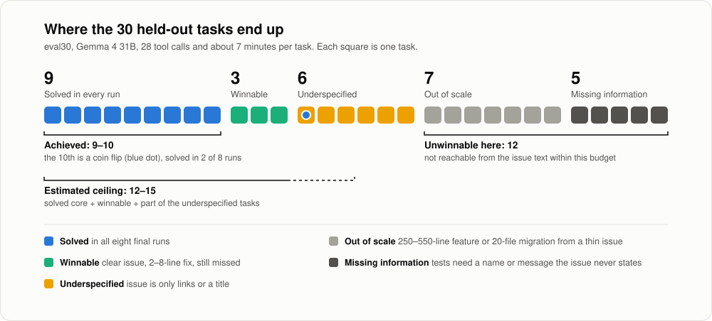

# Most failures were never winnable: auditing the ceiling, the noise and the tool channel of a 31B local coding agent

*Why thirteen prompt, tool, sampling and LoRA submissions of Gemma 4 converged on the same score*

Author: Kapil Chopra

## Abstract

We study Gemma 4 31B (QAT, w4a16) as a coding agent on real GitHub issues: a declarative bundle, 28 tool calls and about 7 minutes per task on four L4 GPUs, judged by hidden tests. Thirteen leaderboard submissions with different prompts, tools, sampling, budgets and self-distilled LoRA adapters scored between 0.12 and 0.18 whenever they finished inside the time limit (three did not and received no score); the same bundle graded twice scored 0.17 and 0.18. We explain the plateau with five measurements. (1) **Outcomes are nearly deterministic per task:** 20 of 30 held-out tasks were never solved in 7–19 runs and 9 almost always were; a second held-out set, run twice, shows the same three groups with more coin-flip tasks (5 of 30). (2) **Most never-solved tasks are not winnable from the issue text within this budget:** checked against their hidden tests, 5 of 21 require a name, exact message or exact output the issue never states, 7 are large features or migrations far beyond a 28-call budget, 6 are underspecified, and only 3 are clearly winnable. (3) **A tool-channel defect costs calls, not solves:** 21–25% of `edit_file` calls arrive garbled because of how multi-argument tool calls are parsed. Routing every edit through one shell string eliminated garbling and cut repeated calls by 40%, but solved the same tasks. (4) **Self-monitoring instructions are mostly ignored:** a rule to check the remaining budget was followed in 2–4 of 30 tasks, no more often than without the rule; a third of tasks still end with no patch. (5) **Self-distilled LoRA** passes a held-out loss gate but adds no solves and makes tasks 29–45% slower, which blanked two submissions at the 12-hour limit.

## 1. Introduction

- **Problem:** strong coding agents rely on large cloud models. The competition asks how far an open 31B model on one 4×L4 node, without internet, gets on real Python issues. The 129 public tasks come from FastAPI, Rich, Requests and HTTPX; the hidden tasks come from private repositories.
- **Setting:** about 120 hidden tasks; about 58 count for the public leaderboard, so one task is 0.017. Participants submit a declarative bundle (prompt, tool list, budgets, sampling, optional skills and LoRA), not agent code. One submission per day; scores arrive 1–2 days later; a run that exceeds 12 hours in total gets no score.
- **Why this paper:** most public effort goes into prompt and budget tweaks judged by single leaderboard scores. We ask instead: of the tasks the agent fails, how many could an agent of this size and budget solve from the information it is given? The answer (few) bounds what tuning can achieve.
- **Contributions:**
  1. A per-task **winnability census** of held-out failures against their hidden tests, giving a realistic local ceiling (12–15 of 30, versus 9–10 achieved).
  2. A per-task stability analysis showing why small eval sets and single leaderboard runs cannot rank configurations.
  3. A diagnosis of **garbled tool calls** (383 of 1,807 edits) and a controlled A/B that removes the defect and shows it was not limiting solves.
  4. Evidence that **prompt rules asking the model to monitor itself** are rarely followed, which bounds what prompt engineering can fix.
  5. Two silent evaluation failures found by a soundness audit.
  6. Self-distilled LoRA on free hardware, and why a loss gate does not predict solve rate or cost.

## 2. Setup

- **Model and serving:** Gemma 4 31B instruction-tuned, QAT w4a16, vLLM, tensor parallel over 4 L4 GPUs, thinking on.
- **Baseline bundle ("b024"):** a public bundle reported at 0.24: shell, file read/edit/write, status, submit and three code-graph tools; 28 calls, 8 minutes, temperature 0.2, thinking budget 4,096, 8,192 output tokens per call.
- **Local evaluation:** the competition's own notebook harness on Kaggle 4×L4 (free weekly quota). **eval30:** 30 sound tasks (17 FastAPI, 13 Rich), never trained on. **eval10:** a 10-task subset. **eval30b:** 30 random tasks from the other 73 sound tasks, which served as the LoRA training pool. Hidden tests serve only as an answer key.

## 3. The leaderboard plateau

| # | Bundle | Public score |
|---|---|---|
| 2, 5 | b024 unchanged (control, twice) | blank, 0.17 |
| 3 | public b024 variant (7 min, 6,144 tokens) | 0.15 |
| 1 | prompt v3b (call-budget wording) | 0.13 |
| 6, 7 | b024 + LoRA (half / full strength) | blank, blank |
| 8 | b024 + LoRA, 6 min, thinking 2,048 | 0.17 |
| 9 | no graph tools, temperature 1.0, top_k 64 | 0.12 |
| 10 | no graph tools, temperature 0.2, 7 min, thinking 2,048, 150 s per command ("v7") | 0.17 |
| 11, 12 | v7 + six tool-mechanics prompt edits ("v7b"), same zip twice | 0.17, 0.18 |
| 13 | v7b without `edit_file`/`write_file`; all edits via one shell string ("v7c", §5) | 0.15 |

- Three bundles that differ in adapter, tools, limits and prompt (#8, #10, #11/#12) score 10–11/58 tasks. The same zip graded twice differed by one task; the byte-identical b024 bundle scored blank and 0.17 for us and 0.24 for its author. A public census by another participant found that byte-identical submissions of the b024 family vary with SD ≈ 1.6 tasks and average about 10/58, so the "0.24" was a high draw.
- **Blanks are the time limit:** 337 s per task at the b024 limits × ~120 tasks plus overhead ≈ 12.2 h. Capping tasks at 7 minutes, thinking at 2,048 tokens and commands at 150 s (#10) cost nothing measurable and has not blanked since. The 7-minute limit is soft: in each of our eight final eval30 runs, 6–8 of 30 tasks ran past 420 s (longest 724 s), with a mean of 282–315 s per task.
- **Graph tools** were declared but never called (0 calls in 453 traces); removing them changed nothing. Temperature 1.0 (#9, 0.12) is within two tasks of the plateau; we reverted it.

## 4. Why the score does not move

### 4.1 Per-task determinism
- **eval10, 12 runs** (all variants): 5 tasks solved in 11–12 runs, 4 never; every "5/10 vs 6/10" comparison was one flipping task.
- **eval30, 7–19 runs per task:** 20 tasks never solved, 9 solved in nearly every run, 1–2 in between. Totals 8–10/30 for every sound variant: baseline 9; call-budget prompt 10; thinking ×2 9; compaction variants 8; 50 calls instead of 28, 9 (the same tasks; the 8-minute limit binds instead). Our final bundles, three runs each: v7b 10, 9, 9; v7c 9, 9, 9; v8 9, 10. The same nine tasks were solved in all eight of these runs.
- **A second held-out set (eval30b),** never used to develop these bundles: two v7c runs solved 12 and 9: 8 tasks in both, 5 in one, 17 in neither. The same three groups appear (a stable core, coin flips and a large unsolved remainder), so the pattern is not an artefact of eval30. There are more coin flips here (5 of 30 versus 1–2), and two runs are weak evidence that the 17 are never solved.
- **Where the coin flips come from:** about a third of task-runs end with an empty patch, mostly at the 28-call cap before any edit. On eval30b the two runs had 6 and 11 empty patches; of the four tasks solved only in the first run, two ended empty in the second, all at 28 calls.
- **Implication:** a change can only show up as a never-solved task turning into a solve. That reframes the question to: which never-solved tasks *can* turn?

### 4.2 Winnability census
- **Method:** for each eval30 task solved in at most 1 of the 7–16 runs available at the time (21 tasks), compare the issue text with the upstream fix and hidden tests. *Unwinnable* covers two kinds of task. *Missing information:* the tests require something the issue does not state, such as a parameter name or an exact message or output. *Out of scale:* the fix is a feature or migration of hundreds of lines, often with new example files, from a title-only or vague issue. Traces were then read for the winnable tasks.
- **Result:**

| Verdict | Tasks | Typical reason |
|---|---|---|
| Unwinnable: missing information | 5 | test calls `openapi_external_docs` where the issue asks for `external_docs`; `pytest.raises(match=…)` on an exact message the issue never gives; exact ANSI colours of new styles |
| Unwinnable: out of scale | 7 | 250–550-line features from a one-line issue; a 20-file migration; new example files and tutorials |
| Underspecified | 6 | issue is only links or a title; or a large rewrite whose exact output follows from stated behaviour |
| Winnable | 3 | clear issue, 2–8-line fix |

*Figure 1. Outcome of each eval30 task, with the achieved score and the estimated ceiling.*

- **Two "near misses" were not near:** where the agent reached the right code repeatedly, the tests required a parameter name and an exact warning text the issue never gives.
- **The three winnable tasks fail for concrete reasons:** one spends most calls fighting backslash quoting in `python -c` and heredocs and never edits the target file; two put a correct helper in the wrong module, or in the right module without changing the caller. None was solved in the eight later runs (v7b, v7c, v8), including two runs whose prompt explicitly required updating a new helper's call sites (§5.2).
- **Ceiling:** 9 nearly always solved + 3 winnable + part of 6 underspecified ≈ **12–15 of 30**. We achieve 9–10. Prompt and sampling changes could move at most a handful of tasks, consistent with the plateau.
- **What the census does not show:** the seven out-of-scale verdicts describe this model and budget (28 calls, 7 minutes), not any agent, and we did not run a stronger model on these tasks to test the verdicts. One underspecified task (rich_3180) was later solved in two of the eight final runs.
- **The prompt's premise is false for some tasks:** every bundle tells the model that the hidden tests were written from the issue text, so its names and messages are the specification. For the five missing-information tasks that is not true.

### 4.3 Local versus leaderboard
Locally we solve 30–40%; on the leaderboard 17%. The hosts state that hidden tasks come from private repositories, validate at 100% with their reference patches, and were screened for impossible tasks (only tasks a strong commercial model solved or failed by one assertion were kept). So the hidden set is likely harder in other ways than our local set, not more unwinnable: the census explains the local plateau, and its share of unwinnable tasks should not be transferred to the hidden set.

## 5. The tool channel and instruction following

### 5.1 Garbled edit calls
- Across all our traces, **383 of 1,807 `edit_file` calls (21%)** failed with "mandatory input parameters are not present". The model usually resent the identical call.
- **Mechanism** (first diagnosed publicly by Emanuele Miranda, confirmed on our traces): arguments are emitted alphabetically, so `new_string` precedes `old_string`; when the model closes `new_string` with a stray backtick, the parser splits the rest at colons and commas. Code with colons and docstrings triggers it.
- **Prompting is not enough:** a fallback rule raised heredoc use (3 → 27) but not garbled edits (13 vs 13): the model kept choosing `edit_file`.
- **Replay:** Miranda's Apache-2.0 SEARCH/REPLACE editor, replayed on our recorded edits, applies 873 of 893 (98%) of them and 58 of 60 garbled calls whose text could be rebuilt.
- **A/B: remove the channel.** A first field test was invalid (the editor needed an install call that the model skipped in all 10 tasks). We then removed `edit_file` and `write_file` entirely ("v7c"): every edit is one `run_command` running a short Python script that asserts the old text occurs exactly once and replaces it. Three eval30 runs each, everything else identical:

| | v7b (edit tool) | v7c (shell string) |
|---|---|---|
| Garbled edit calls | 41 of 163 (25%) | 0 |
| Edits applied | — | 109 of 119 (92%; 8 not found, 2 not unique) |
| Identical repeated calls (per run) | 54, 69, 58 | 31, 44, 27 |
| Solved (per run) | 10, 9, 9 | 9, 9, 9 |
| Empty patches (per run) | 6, 10, 8 | 9, 12, 9 |
| Leaderboard | 0.17, 0.18 | 0.15 |

- **Garbling cost calls, not solves.** The same nine tasks were solved in all six runs; the only difference is one coin-flip task. Garbled calls occurred at the same rate (~15% of calls) in solved and unsolved task-runs, and solved runs recovered from them. Miranda likewise reports malformed calls dropping from 77 to 0 with a score change within noise. The leaderboard gap (0.15 vs 0.17–0.18, one to two tasks) is within the spread of byte-identical submissions (§3).
- **The saved calls were not converted into progress:** total tool calls stayed at about 700–750 per run in both arms, and empty patches did not fall (24 versus 30 over three runs).

### 5.2 Instructions the model does not follow
- About a third of task-runs end with no patch, mostly out of calls before any edit. The model cannot count its own calls, but a status tool reports the remaining calls and time. We added two generic rules ("v8"): after locating the target (about call 8), call the status tool and, if 16 or fewer calls remain with no edit yet, make a best-guess edit next; and if the fix adds a helper, grep its call sites and change them.
- **Result (two eval30 runs):** 9 and 10 solved, the same core. The status check was made in 4 and 2 of 30 tasks (1–5 without the rule, so the rule did not make the check more frequent); when it was made before any edit, the next call was an edit every time, so the rule works when followed. Empty patches: 10 and 8 (v7c: 9, 12, 9). On the helper task, both runs produced the identical patch to the helper module and never searched for callers. A 10-task run of the same rules on v7b likewise solved its 6 always-solved tasks and none of 4 targets, with 0 status checks.
- **Implication:** rules asking the model to monitor its progress or take a follow-up step are followed in about one task in ten; empty patches need a mechanism outside the model, which a declarative bundle cannot add.

## 6. Evaluation pitfalls

- **Task soundness:** an empty patch must fail and the reference patch must pass. Naively 71/129 tasks were sound; most failures were missing test-only packages. With them installed: 103/129 (Requests 0/13 still broken).
- **Dependency leakage:** reproducing the grader elsewhere, 14 of 30 FastAPI tasks failed because the sandbox includes the host's site-packages and installing vLLM had upgraded starlette; Pygments similarly changed Rich's output. Pinning both: 30/30 sound. Any benchmark that runs tests in an environment shared with the agent's stack can silently mark correct patches wrong.

## 7. Self-distilled LoRA

- **Data:** 35 solved runs of the base agent on the training pool, as full chats (85 windows of ≤16k tokens). No outputs from other models.
- **Training:** rank 16, alpha 32, all 7 projections of all 60 layers, 1 epoch, on four free Kaggle L4s (head_dim 512 needs attention computed in checkpointed slices; 18.2 GB peak per GPU).
- **Gate:** held-out loss with versus without the adapter; pass if it rises at most 15%. Run2 −28%, run3 −24%: both pass.
- **What the gate missed:** both solved 5/10 on eval10 versus base 6/10 (the flipping task). They write more per step (279 → 418–460 completion tokens per call) at ~11% lower decode speed, so tasks took 29–45% longer. Typical steps are no longer; the difference is steps that run to the thinking budget (base 3, run3 13), mostly degenerate repetition late in long contexts. Both full-limit adapter submissions blanked; with 6 minutes and thinking 2,048 the adapter scored 0.17, the plateau. A frequency penalty of 0.3 broke 5 of 16 tool calls on replayed loop steps.
- **Lesson:** a loss gate checks closeness to past behaviour, not solve rate or cost. Gate adapters on target hardware for per-task time and tail output length. Given §4.2, self-distillation on solved runs also cannot teach information the issue does not contain.

## 8. Related work

- **SWE-bench** (Jimenez et al., 2024) introduced repository-level issue resolution with hidden tests. **SWE-bench Verified** (OpenAI, 2024) had annotators remove tasks with underspecified issues or tests that check unstated details; our census applies the same criterion per failure and shows that, without such filtering, most residual failures of a mid-size model are of this kind.
- **SWE-agent** (Yang et al., 2024) showed that the agent–computer interface, including edit-tool design, strongly affects success; §5 is a serving-level instance where the defect lies in argument parsing rather than tool semantics.
- **Self-training on own successes:** STaR (Zelikman et al., 2022), rejection-sampling fine-tuning (Yuan et al., 2023) and SWE-Gym (Pan et al., 2025), which trains SWE agents on their own successful trajectories.
- **Parameter-efficient fine-tuning:** LoRA (Hu et al., 2022) and QLoRA (Dettmers et al., 2023).
- **Evaluation noise:** Madaan et al. (2024) quantify run-to-run variance. On this competition, participants report identical bundles scoring 0.15–0.24 (Kaggle discussions 753524, 757588), a per-task flip rate of 15% between identical passes (747168), and prompt-step rules skipped in most tasks (747923, 745774), consistent with §4.1 and §5.2.

## 9. Limitations

- Local sets are small (10, 30 and 30 tasks) and cover two repositories; Requests could not be made sound.
- The census (§4.2) was done by one LLM analyst with the answer key and checked by one author, on public tasks that, unlike the hidden ones, were not screened for feasibility; borderline calls could go either way, hence the ceiling range. No second rater and no stronger model tested the verdicts, and 7 of the 12 unwinnable verdicts rest on scale rather than missing information.
- Per-task stability (§4.1) was measured at temperature 0.2; temperature 1.0 was tried only on the leaderboard (#9), so part of the stability may come from low-temperature sampling. eval30b was run only twice.
- The replay in §5 measures whether recorded edits would apply, not whether the model would write the same edits with a different tool.
- Leaderboard conclusions rest on thirteen submissions, one per day, each ±3 tasks; the v7c leaderboard A/B is a single pair of draws.
- Rule-following (§5.2) was measured for two generic rules on one model; other phrasings or placements might be followed more often.

## 10. Reproducibility

- Public companion repository: github.com/kapch1980/gemma4-dev-agent-paper (bundles, scripts, per-task scores; no competition data).
- Scripts in `scripts/` (bundle check, trace audit, editor replay, LoRA training and gate). Census: `results/eval30-winnability.md` (task IDs and reasons only).
- Bundles: `bundles/v7`, `bundles/v7b`, `bundles/v7c`, `bundles/v8`, `bundles/v8b`, `bundles/v6b`; task lists `results/eval_set_30b.txt`. Compute: Kaggle free quota for evaluation and round-3 training; a laptop; one rented H200 (~$2).
- The repository holds per-task results for the eight final eval30 runs, the two eval30b runs and the v8b check. The earlier runs behind the 7–19 runs-per-task counts (§4.1), the eval10 runs and the LoRA runs are not included.

## References

- Jimenez, C. E., et al. (2024). SWE-bench: Can Language Models Resolve Real-World GitHub Issues? ICLR. arXiv:2310.06770.
- OpenAI (2024). Introducing SWE-bench Verified. openai.com/index/introducing-swe-bench-verified.
- Yang, J., et al. (2024). SWE-agent: Agent-Computer Interfaces Enable Automated Software Engineering. NeurIPS. arXiv:2405.15793.
- Zelikman, E., et al. (2022). STaR: Bootstrapping Reasoning With Reasoning. NeurIPS. arXiv:2203.14465.
- Yuan, Z., et al. (2023). Scaling Relationship on Learning Mathematical Reasoning with Large Language Models. arXiv:2308.01825.
- Pan, J., et al. (2025). Training Software Engineering Agents and Verifiers with SWE-Gym. ICML. arXiv:2412.21139.
- Hu, E. J., et al. (2022). LoRA: Low-Rank Adaptation of Large Language Models. ICLR. arXiv:2106.09685.
- Dettmers, T., et al. (2023). QLoRA: Efficient Finetuning of Quantized LLMs. NeurIPS. arXiv:2305.14314.
- Madaan, L., et al. (2024). Quantifying Variance in Evaluation Benchmarks. arXiv:2406.10229.
- Miranda, E. (2026). gemma4-swe-agent (Apache-2.0). github.com/emamira02/gemma4-swe-agent; Kaggle discussion 755172.
