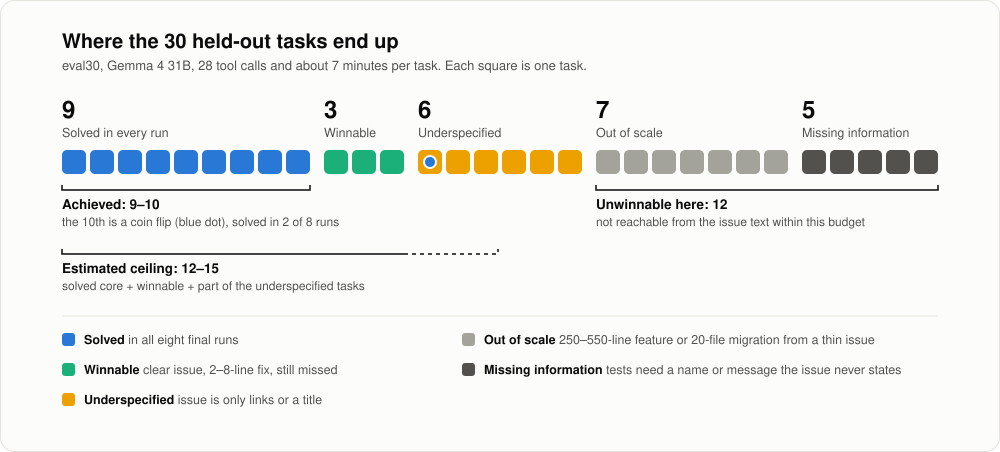

# Gemma 4 Developer Agent: paper companion

Code, agent bundles and per-task scores for the paper *Most failures were never winnable: auditing the ceiling, the noise and the tool channel of a 31B local coding agent* (Kaggle, Google – The Gemma 4 Developer Agent Paper Track, 2026). Author: Kapil Chopra.

*The paper's main result (Figure 1, §4.2): of 30 held-out tasks, 9 are solved in every run and 12 are not reachable from the issue text within the budget.*

This repository holds no competition data: no task text, hidden tests, reference patches, agent traces or logs. Task IDs and per-task numbers only.

## Contents

| Path | What |
|---|---|
| `PAPER.md` | The paper |
| `figures/` | Figure 1 as SVG and PNG |
| `bundles/` | Submitted agent bundles (prompt, tools, limits, sampling): `v7`, `v7b` (#10–#12), `v7c` (#13, no edit tool), `v8`, `v8b` (#14), `v6b` (editor skill) |
| `results/eval_set_30.txt`, `eval_set_30b.txt`, `eval_set_10_v8b.txt`, `sound_tasks.txt` | Task-ID lists for the local evaluation sets; `sound_tasks.txt` lists the 103 local tasks whose empty patch fails and reference patch passes |
| `results/<run>/eval_results.csv` | One row per task: resolved, patch size, tool calls, seconds |
| `results/eval30-winnability.md` | Census verdicts by task ID (§4.2) |
| `scripts/` | `check_bundle.py` (compile a bundle with the grader's library), `mechanics_audit.py` and `show_trace.py` (trace analysis), `editor_replay.py` (§5.1 replay), `train_lora_*.py`, `prep_windows.py`, `build_sft.py`, `compare_lora_loss.py` (LoRA pipeline and gate, §7), `verbosity_probe.py`, `loop_probe.py`, `sampling_probe.py` |

Run names map to the paper as follows: `eval30-v7b*` = v7b ×3, `eval30-v7c*` = v7c ×3 (§5.1), `eval30-v8-*` = v8 ×2 (§5.2), `eval30b-v7c-*` = second held-out set (§4.1), `eval10-v8b` = v8b check.

## Leaderboard after the paper

The paper's table (§3) ends at #14. Submissions made after it was submitted on 12 Nov 2026:

| # | Bundle | Public score |
|---|---|---|
| 15 | v8b, same zip as #14 | 0.13 |
| 16 | v7b, same zip as #11 and #12 | pending |

The v8b zip scored 0.18 and then 0.13, about three tasks apart out of 58. That is wider than the one-task gap the paper reports for v7b (#11 and #12). It also fits the public census figure of SD ≈ 1.6 tasks for byte-identical submissions. A single submission cannot separate two bundles that are within two or three tasks of each other.

## Reproducing

Evaluation used the competition's own notebook harness on Kaggle's free 4×L4 quota (about 3.5 h per 30-task run). Load a bundle from `bundles/`, select the task IDs from `results/`, and compare with the CSVs. The trace scripts need the traces the harness writes, which are not redistributed here.

## Credits

- The tool-mechanics prompts build on the public "0.24" baseline bundle (Kaggle notebook `honghanhhh/gemma-4-baseline-lb-0-24`).
- `bundles/v6b/skills/editor` adapts Emanuele Miranda's SEARCH/REPLACE editor ([gemma4-swe-agent](https://github.com/emamira02/gemma4-swe-agent), Apache-2.0); its licence is kept in that folder. Miranda first diagnosed the garbled `edit_file` calls publicly.

## Licence

Apache-2.0 (see `LICENSE`).
